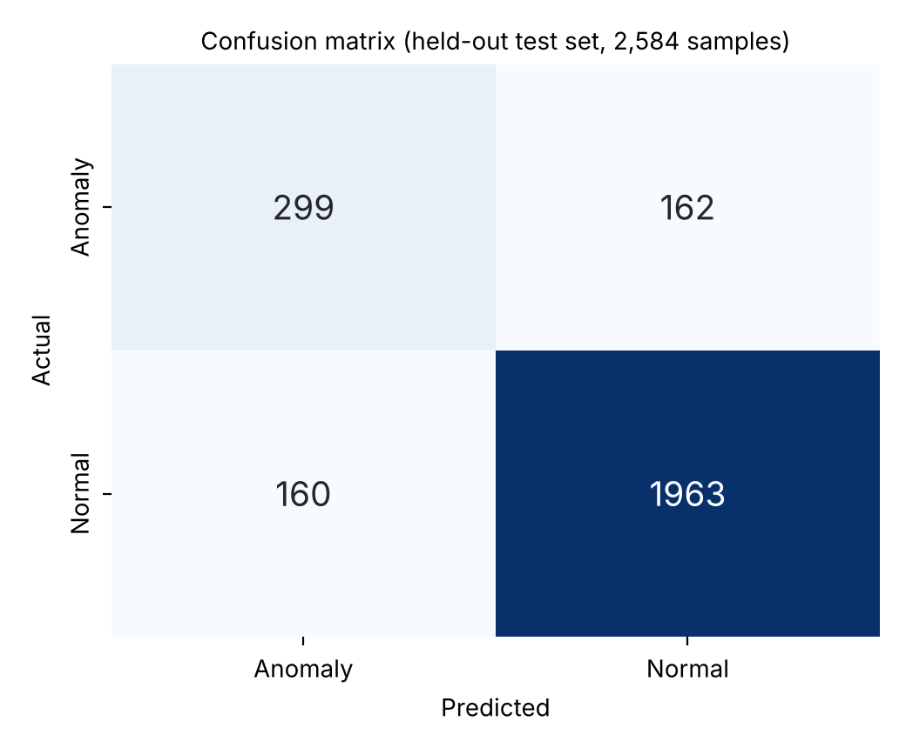
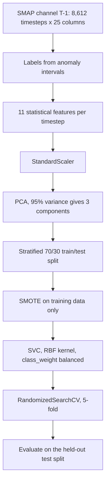
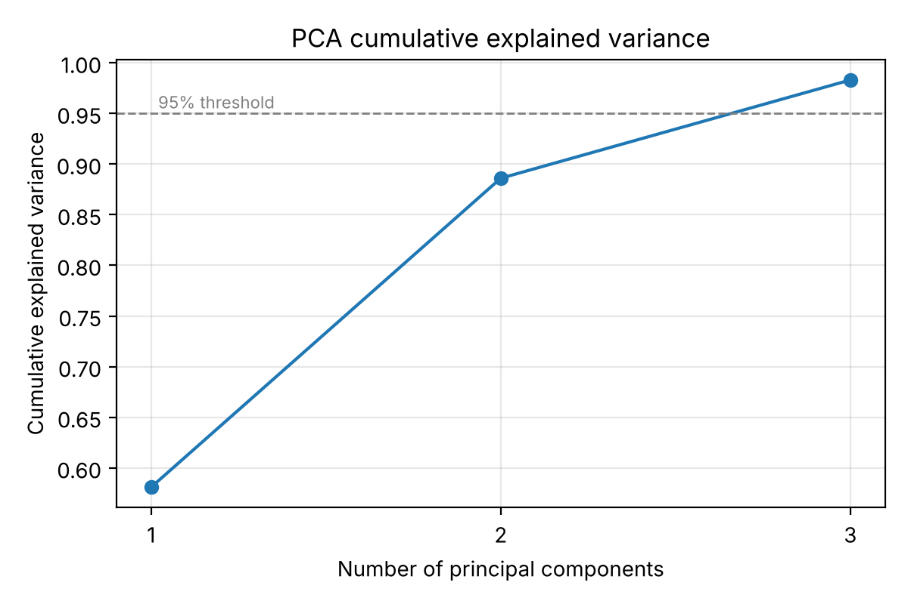

# Spacecraft Telemetry Anomaly Detection (NASA SMAP)

A supervised machine learning pipeline that flags anomalous timesteps in NASA SMAP spacecraft telemetry. It builds a labelled dataset from anomaly metadata, extracts statistical features, reduces them with PCA, handles class imbalance with SMOTE, and classifies each timestep as normal or anomalous with an RBF-kernel SVC.

Built during my Machine Learning Research Internship at the Indian Institute of Technology Patna (May to July 2025). The full write-up is in [`docs/report.pdf`](docs/report.pdf).

## Results

Evaluated on a held-out 30% test split of one SMAP telemetry channel (T-1): 2,584 timesteps, of which 461 are anomalous.

| Class | Precision | Recall | F1 | Support |
| --- | --- | --- | --- | --- |
| Anomaly | 0.65 | 0.65 | 0.65 | 461 |
| Normal | 0.92 | 0.92 | 0.92 | 2,123 |
| **Accuracy** | | | **0.88** | 2,584 |



The model finds 299 of the 461 anomalous timesteps and raises 160 false alarms. Anomalies are the minority class (about 18% of the channel), so read the anomaly precision and recall rather than accuracy.

These numbers come from the run saved in the notebook. `RandomizedSearchCV` is not seeded, so a re-run may pick different hyperparameters and shift the anomaly precision and recall by a few points. Re-running the notebook unchanged reproduced the numbers above.

## Approach

The paper *Anomaly Detection of Spacecraft Based on Least Squares Support Vector Machine* (Xiong et al., 2011) was used as a **methodological reference**. This is not an exact reproduction.

| | Reference paper | This project |
| --- | --- | --- |
| Data | Two spacecraft components, 10-minute sampling | NASA SMAP telemetry, one channel (T-1, 8,612 timesteps) |
| Classifier | LS-SVM | scikit-learn SVC (RBF kernel) |
| Tuning | Particle Swarm Optimization | RandomizedSearchCV |
| Imbalance handling | Not the focus | SMOTE on the training set only |

The results are not comparable to the paper's reported accuracy, because the data and the task setup differ.



### 1. Data and labels

Channel T-1 has 8,612 timesteps. Each timestep has 25 input columns: one telemetry value and 24 binary columns.

The anomaly intervals come from `data/labeled_anomalies.csv`. For this channel there are two intervals, with inclusive end indices:

| Interval | Type | Timesteps |
| --- | --- | --- |
| 2399 to 3898 | point | 1,500 |
| 6550 to 6585 | contextual | 36 |

That gives 1,536 anomalous timesteps out of 8,612 (about 18%). [`scripts/build_labels.py`](scripts/build_labels.py) maps these intervals onto the raw telemetry and reproduces `data/T-1_final_labeled.csv` exactly (run it with `--check` to verify).

### 2. Features

Eleven statistical features are computed for each timestep across its 25 columns: mean, standard deviation, variance, minimum, maximum, peak-to-peak, RMS, skewness, kurtosis, and the mean first-order and second-order differences. There is no sliding window, so each timestep is classified on its own.

### 3. Scaling and PCA

Features are standardized with `StandardScaler`. PCA keeps enough components to explain 95% of the variance, which gives **3 components** (98.3% cumulative variance).



### 4. Class imbalance

SMOTE is applied to the training split only. The test split keeps its natural class distribution.

### 5. Model and tuning

An SVC with an RBF kernel and `class_weight="balanced"` is tuned with `RandomizedSearchCV` (5-fold, `scoring="recall"`) over `C` in {1, 10, 100, 120} and `gamma` in {0.01, 0.05, 0.1, 1}. The saved run selected `C = 1` and `gamma = 0.01`.

## Limitations

Please read the results with these in mind:

- **Random split of neighbouring timesteps.** Train and test timesteps are drawn at random from the same two anomaly intervals, and adjacent timesteps are very similar. The scores therefore show how well the model separates timesteps from *these* intervals, not how well it would detect a new, unseen anomaly. A time-ordered split or holding out whole intervals would be a harder and more realistic test.
- **One channel, two anomaly intervals.** Nothing here shows generalisation to other channels or spacecraft.
- **No temporal context.** Features are computed per timestep, not over windows.
- **Anomaly precision and recall are 0.65.** About a third of anomalies are missed and about a third of alerts are false.
- **Tuning details.** `scoring="recall"` scores the class labelled `1`, which is the *normal* class in this dataset. Tuning for anomaly recall would need `pos_label=-1`. SMOTE is also applied before cross-validation, so CV scores can be optimistic.
- This is an offline experiment. It has not been deployed or run on live telemetry.

## Explored but not in this repository

The report describes two further experiments whose code is not included here: Particle Swarm Optimization for hyperparameters (marginal and inconsistent gains, so RandomizedSearchCV was kept), and a second-stage classifier for point versus contextual anomalies. The contextual class has only 36 timesteps against 1,500 point timesteps (about 42 to 1), and resampling did not help, so that stage was dropped.

## Future work

- Evaluate with a time-ordered or interval-held-out split.
- Compute features over sliding windows.
- Seed the search, tune for anomaly recall (`pos_label=-1`), and put scaling, PCA and SMOTE inside a pipeline so they are fitted inside each cross-validation fold.
- Combine several channels and compare against other models.

## Repository structure

```text
.
├── notebooks/
│   └── Anomaly_Detection_Spacecraft.ipynb
├── scripts/
│   └── build_labels.py        # rebuilds the labelled dataset
├── data/
│   ├── raw_Channel_T-1.npy
│   ├── labeled_anomalies.csv
│   └── T-1_final_labeled.csv
├── docs/
│   ├── report.pdf
│   └── images/
├── requirements.txt
└── README.md
```

## Run it

```bash
git clone https://github.com/m-s-shanmukha-aditya/smap-spacecraft-anomaly-detection.git
cd smap-spacecraft-anomaly-detection
python -m venv .venv
source .venv/bin/activate        # Windows: .venv\Scripts\activate
pip install -r requirements.txt
jupyter notebook notebooks/Anomaly_Detection_Spacecraft.ipynb
```

Run the notebook from the `notebooks/` folder; it reads `../data/T-1_final_labeled.csv`. Tested with Python 3.12, scikit-learn 1.9 and imbalanced-learn 0.14.

## Data

The telemetry and anomaly labels come from the NASA SMAP dataset with labelled anomalies, released with *Detecting Spacecraft Anomalies Using LSTMs and Nonparametric Dynamic Thresholding* (Hundman et al., KDD 2018). Credit and licence belong to the original authors; only channel T-1 and the anomaly metadata are included here.

## References

1. Xiong, L., Ma, H.-D., Fang, H.-Z., Zou, K.-X., Yi, D.-W. "Anomaly detection of spacecraft based on least squares support vector machine." 2011 Prognostics and System Health Management Conference, IEEE, 2011.
2. Hundman, K., Constantinou, V., Laporte, C., Colwell, I., Soderstrom, T. "Detecting Spacecraft Anomalies Using LSTMs and Nonparametric Dynamic Thresholding." KDD 2018.

## Author

Built by [Shanmukha Aditya](https://github.com/m-s-shanmukha-aditya) · [Portfolio](https://shanmukha-aditya.vercel.app) · [LinkedIn](https://linkedin.com/in/m-s-shanmukha-aditya)
